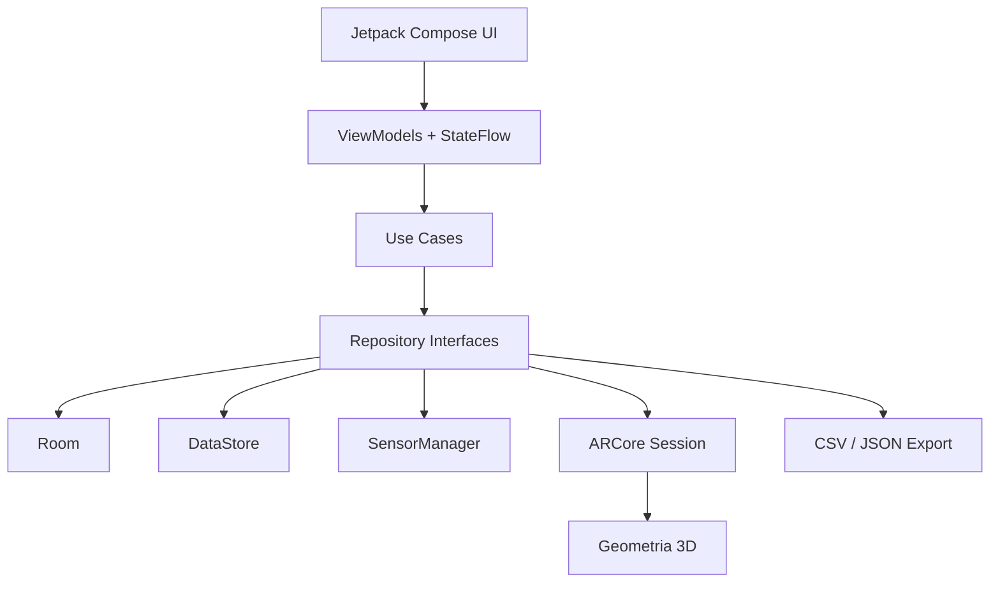

# VCC Measure — Especificação Técnica e Roadmap do MVP

**Plataforma:** Android  
**Stack:** Kotlin, Jetpack Compose, Material 3, MVVM, Clean Architecture, Room, DataStore, Hilt, ARCore  
**Versão do documento:** 1.0 — 23/10/2026  
**Objetivo:** aplicação híbrida de medições com ferramentas de ecrã, sensores e realidade aumentada.

## 1. Visão geral

A VCC Measure transforma um smartphone Android numa caixa de ferramentas de medição. As ferramentas tradicionais devem funcionar sem rede e independentemente do suporte ARCore. As funcionalidades de realidade aumentada só ficam disponíveis em dispositivos compatíveis.

### Objetivos

- Medir comprimentos diretamente no ecrã com régua calibrável.
- Medir ângulos e inclinações com transferidor e sensores.
- Medir distâncias e áreas com ARCore.
- Guardar medições em projetos, consultar histórico e exportar resultados.
- Indicar limitações de precisão e compatibilidade sem sugerir certificação metrológica.

## 2. Âmbito funcional

| Funcionalidade | Implementação | MVP |
|---|---|---|
| Régua digital | Compose Canvas, escala calibrável, cursores | Sim |
| Transferidor | Compose Canvas, linhas e ângulos | Sim |
| Nível de bolha | SensorManager, gravidade/acelerómetro | Sim |
| Inclinómetro | SensorManager, filtragem e calibração | Sim |
| Bússola | Sensores de rotação/magnetómetro, quando disponíveis | Sim, condicional |
| Conversor de unidades | Kotlin puro | Sim |
| Distância em AR | ARCore, hit testing, pontos 3D | Sim |
| Área em AR | ARCore, polígono coplanar | Sim |
| Projetos e histórico | Room | Sim |
| Exportação CSV e JSON | Storage Access Framework / partilha | Sim |
| Altura e volume AR | Geometria 3D | Pós-MVP |
| Sonómetro e luxímetro | Microfone / sensor de luz | Pós-MVP |
| Relatórios PDF | PdfDocument | Pós-MVP |

## 3. Requisitos não funcionais

- **Offline-first:** sem backend ou autenticação obrigatórios.
- **Compatibilidade:** funcionalidades base disponíveis mesmo sem ARCore.
- **Privacidade:** pedir acesso à câmara apenas ao abrir AR; dados locais por defeito.
- **Acessibilidade:** suporte a tamanhos de texto, contraste e descrições acessíveis.
- **Desempenho:** processar sensores sem bloquear a thread principal; libertar a sessão AR em pausa.
- **Fiabilidade:** tolerar ausência de sensores, tracking insuficiente e cancelamento de permissões.
- **Precisão:** apresentar qualidade/limitações e permitir calibração, sem prometer tolerâncias universais.
- **Internacionalização:** pt-PT inicial; arquitetura preparada para outras línguas.

## 4. Arquitetura técnica



### Organização sugerida

```text
com.vcc.measure/
├── app/
│   ├── MainActivity.kt
│   ├── VCCMeasureApp.kt
│   └── navigation/
├── core/
│   ├── database/
│   ├── datastore/
│   ├── designsystem/
│   ├── geometry/
│   ├── sensors/
│   ├── ar/
│   ├── permissions/
│   └── export/
├── domain/
│   ├── model/
│   ├── repository/
│   └── usecase/
└── feature/
    ├── home/
    ├── ruler/
    ├── level/
    ├── inclinometer/
    ├── protractor/
    ├── compass/
    ├── armeasure/
    ├── projects/
    ├── history/
    └── settings/
```

Para o MVP, pode começar-se com um módulo `app` organizado por packages e extrair módulos Gradle quando houver necessidade real de isolamento.

### Stack

| Camada | Tecnologia |
|---|---|
| UI | Kotlin + Jetpack Compose + Material 3 |
| Navegação | Navigation Compose |
| Estado | ViewModel + StateFlow |
| DI | Hilt |
| Persistência | Room |
| Preferências | DataStore |
| Sensores | Android SensorManager |
| AR | Google ARCore |
| Câmara AR | Câmara gerida pela sessão ARCore |
| Exportação | Kotlin + SAF / FileProvider |
| Testes | JUnit, coroutines test, Compose UI tests |

As versões das dependências devem ser fixadas e validadas no início do projeto, sem assumir números não verificados neste documento.

## 5. Ecrãs e fluxos

### 5.1 Home
- Grelha: Régua, Nível, Inclinómetro, Transferidor, Bússola, Distância AR, Área AR, Conversor.
- Estado de compatibilidade dos sensores/AR.
- Atalhos para projetos e últimas medições.

### 5.2 Régua
- Escala em mm/cm/polegadas, orientação horizontal/vertical.
- Dois marcadores deslocáveis; valor da distância entre marcadores.
- Calibração com referência de comprimento conhecido.
- Botões: calibrar, trocar unidade, repor, guardar.

### 5.3 Nível e inclinómetro
- Indicador de bolha em dois eixos, graus, estabilização e zero relativo.
- Estado do sensor e indicação de leitura instável.
- Calibração por orientação; guardar medição.

### 5.4 Transferidor
- Base 0–360°, duas linhas móveis, ângulo interior/exterior.
- Alternar unidades de apresentação se necessário; guardar.

### 5.5 Bússola
- Direção cardinal, azimute, aviso de interferência magnética.
- Desativar quando sensores necessários não existem.

### 5.6 Medição AR
- Pedido de permissão da câmara e verificação de ARCore.
- Instrução para mover o dispositivo e identificar planos.
- Mira central, botão para colocar ponto, desfazer, limpar.
- Modo distância: dois pontos 3D; modo área: três ou mais pontos coplanares.
- Feedback de tracking e aviso de medição aproximada.
- Guardar medição e metadados relevantes.

### 5.7 Projetos
- Criar, editar, arquivar e eliminar projetos.
- Listar medições por projeto; exportar projeto.

### 5.8 Histórico / detalhe
- Filtros por tipo, data e projeto.
- Valor, unidade, método, data, qualidade e observações.
- Renomear, mover para projeto, eliminar e exportar.

### 5.9 Definições
- Unidade preferida, casas decimais, tema, calibrações, permissões e diagnóstico.

### Navegação

```text
Home
├── Ferramentas
│   ├── Régua
│   ├── Nível / Inclinómetro
│   ├── Transferidor / Bússola
│   └── Medição AR (distância / área)
├── Projetos -> Projeto -> Detalhe da medição
├── Histórico -> Detalhe da medição
└── Definições -> Calibração / Diagnóstico
```

## 6. Modelo de dados Room

### 6.1 ProjectEntity

| Campo | Tipo | Notas |
|---|---|---|
| id | String (UUID) | PK |
| name | String | Obrigatório |
| description | String? | Opcional |
| createdAt | Long | Epoch milliseconds |
| updatedAt | Long | Epoch milliseconds |
| archived | Boolean | Default false |

### 6.2 MeasurementEntity

| Campo | Tipo | Notas |
|---|---|---|
| id | String (UUID) | PK |
| projectId | String? | FK opcional para projeto |
| type | String | RULER, LEVEL, INCLINATION, ANGLE, COMPASS, AR_DISTANCE, AR_AREA |
| valueSI | Double | Metros, m² ou radianos consoante dimensão |
| dimension | String | LENGTH, AREA, ANGLE |
| displayUnit | String | cm, mm, m, in, m2, deg, etc. |
| label | String | Nome da medição |
| notes | String? | Opcional |
| method | String | SCREEN, SENSOR, AR |
| quality | String | UNKNOWN, LOW, MEDIUM, HIGH (qualitativo) |
| calibrationId | String? | Referência à calibração |
| createdAt | Long | Epoch milliseconds |

**Nota:** `valueSI` representa a grandeza na unidade SI: comprimento em metros, área em metros quadrados e ângulo em radianos. O tipo/dimensão deve ser sempre considerado ao interpretar o valor.

### 6.3 MeasurementPointEntity

| Campo | Tipo | Notas |
|---|---|---|
| id | String | PK |
| measurementId | String | FK |
| sequence | Int | Ordem do ponto |
| x, y, z | Double | Coordenadas locais da medição, em metros |

### 6.4 CalibrationEntity

| Campo | Tipo | Notas |
|---|---|---|
| id | String | PK |
| toolType | String | RULER, LEVEL, INCLINOMETER, etc. |
| deviceKey | String | Identificação não sensível do perfil de ecrã/dispositivo |
| parametersJson | String | Fatores e offsets versionados |
| calibratedAt | Long | Data |

### 6.5 AttachmentEntity

| Campo | Tipo | Notas |
|---|---|---|
| id | String | PK |
| measurementId | String | FK |
| uri | String | URI de ficheiro privado ou com permissão persistida |
| mimeType | String | image/jpeg, etc. |
| createdAt | Long | Data |

### Índices e integridade
- Índices `Measurement(projectId, createdAt)`, `Measurement(type, createdAt)` e `MeasurementPoint(measurementId, sequence)`.
- Foreign keys com políticas de eliminação definidas (cascade para pontos/anexos; comportamento explícito ao apagar projetos).
- Migrações Room versionadas; evitar `fallbackToDestructiveMigration` em produção.
- Exportar valores SI, unidade de apresentação, dimensão, método e data.

## 7. Regras de cálculo

### 7.1 Régua

A dimensão em milímetros depende dos pixels físicos e da densidade real do ecrã:

```text
comprimento_mm = delta_pixels / pixels_por_mm_calibrados
```

`xdpi/ydpi` podem ser imprecisos: disponibilizar calibração manual por eixo e por orientação, com validação visual.

### 7.2 Distância AR

Para dois pontos 3D `P1` e `P2`, em metros:

```text
d = sqrt((x2-x1)^2 + (y2-y1)^2 + (z2-z1)^2)
```

Usar pontos expressos no mesmo referencial local; não assumir que coordenadas de sessões ARCore diferentes são comparáveis.

### 7.3 Área AR

- Exigir pelo menos três pontos.
- Verificar coplanaridade dentro de tolerância documentada.
- Projetar os pontos num referencial 2D do plano.
- Verificar auto-interseções e calcular a área pela fórmula do polígono (shoelace).
- Rejeitar ou pedir correção em caso de polígono inválido.

### 7.4 Inclinação

Calcular inclinação com base no vetor gravidade e na orientação do dispositivo. Aplicar filtragem para reduzir ruído e permitir zero relativo. Documentar claramente o eixo e a convenção angular exibida.

### 7.5 Unidades

- Comprimento: mm, cm, m, km, in, ft.
- Área: cm², m², ft².
- Ângulo: graus e radianos.
- Guardar valor SI com `Double`; arredondar apenas na apresentação.

## 8. Integração ARCore

### 8.1 Compatibilidade

O modo de instalação deve ser **AR Optional**, para não impedir a utilização em dispositivos sem ARCore.

```xml
<uses-permission android:name="android.permission.CAMERA" />
<uses-feature
    android:name="android.hardware.camera.ar"
    android:required="false" />

<application>
    <meta-data
        android:name="com.google.ar.core"
        android:value="optional" />
</application>
```

Os elementos `<uses-permission>` e `<uses-feature>` pertencem ao nível `<manifest>`; `<meta-data>` pertence a `<application>`. Este excerto deve ser integrado no manifesto completo da aplicação.

### 8.2 Fluxo de execução

1. Consultar `ArCoreApk.checkAvailability()` e tratar estados transitórios.
2. Pedir permissão de câmara no momento de entrada na funcionalidade.
3. Usar `ArCoreApk.requestInstall()` quando aplicável.
4. Criar e configurar `Session` após validações.
5. Detetar planos e avaliar `TrackingState.TRACKING`.
6. Efetuar hit testing, validar o resultado e recolher pontos.
7. Renderizar pontos/segmentos e atualizar resultados.
8. Libertar recursos em `onPause`/`onDestroy` conforme o ciclo de vida.

### 8.3 Gestão de erros

- ARCore não suportado: apresentar mensagem e permitir ferramentas tradicionais.
- Permissão negada: explicar e oferecer nova tentativa.
- Tracking insuficiente: bloquear colocação de pontos e mostrar instruções.
- Pouca luz / superfícies sem textura: avisar sobre qualidade.
- Plano não detetado: solicitar movimento lento da câmara.
- Sessão interrompida: preservar apenas medições já confirmadas.

### 8.4 Precisão

ARCore não é instrumento certificado. Evitar percentagens fixas de precisão sem ensaios. A classificação de qualidade deve basear-se em critérios observáveis e ser apresentada como indicativa.

## 9. Sensores e calibração

- Preferir `TYPE_GRAVITY`; usar acelerómetro filtrado como alternativa.
- Para bússola, utilizar sensores disponíveis de campo magnético/rotação e calcular orientação com a API Android apropriada.
- Registar listeners apenas enquanto a ferramenta está visível.
- Não manter processamento de sensores em background sem necessidade.
- Guardar fatores e offsets de calibração por ferramenta e dispositivo.
- Permitir repor calibrações e testar com referências conhecidas.

## 10. Exportação

### CSV

Colunas sugeridas:

```csv
id,projectId,type,dimension,valueSI,displayUnit,method,quality,label,createdAt
```

### JSON

```json
{
  "schemaVersion": 1,
  "app": "VCC Measure",
  "measurements": [
    {
      "id": "sample-001",
      "type": "AR_DISTANCE",
      "dimension": "LENGTH",
      "valueSI": 1.25,
      "displayUnit": "cm",
      "method": "AR",
      "quality": "MEDIUM",
      "label": "Largura da mesa",
      "createdAt": 1792792800000
    }
  ]
}
```

**Atenção:** `displayUnit` representa a unidade de apresentação preferida; `valueSI` mantém-se em SI. No exemplo, `1.25` significa 1,25 m, embora a apresentação possa ser feita em centímetros.

Utilizar Storage Access Framework para escolha do destino, ou FileProvider para partilha temporária. Não exigir permissões amplas de armazenamento.

## 11. Segurança e privacidade

- Sem backend e sem conta no MVP.
- Base de dados privada da aplicação.
- Câmara usada apenas na medição AR, com autorização explícita.
- Não recolher localização por defeito.
- Exportações iniciadas pelo utilizador.
- Não incluir imagens ou dados sensíveis em logs.
- Preparar política de privacidade antes de publicação.

## 12. Estratégia de testes

### Unitários
- Conversões de unidades e arredondamentos de apresentação.
- Distância 3D, área de polígonos, deteção de geometrias inválidas.
- Normalização de ângulos, tratamento de NaN/infinito.
- Regras de persistência e mapeamento de entidades.

### Instrumentados / UI
- Navegação, estados sem sensores, permissões e histórico.
- Migrações Room.
- Calibração em orientações e densidades distintas.
- Ciclo de vida de ARCore e recuperação após pausa.

### Testes físicos
- Medir referências reais conhecidas com régua e AR.
- Validar nível em superfície de referência.
- Ensaiar AR em diferentes condições de iluminação e textura.
- Testar em dispositivos com e sem suporte ARCore.

## 13. Roadmap do MVP

| Sprint | Duração estimada | Entregáveis |
|---|---|---|
| 1 — Fundação | 1 semana | Projeto, navegação, UI base, Hilt, Room, DataStore |
| 2 — Ferramentas digitais | 1–2 semanas | Régua, transferidor, conversões, calibração |
| 3 — Sensores | 1 semana | Nível, inclinómetro, bússola condicional |
| 4 — ARCore | 2–3 semanas | Compatibilidade, tracking, pontos, distância, área |
| 5 — Dados/exportação | 1 semana | Projetos, histórico, CSV, JSON |
| 6 — Qualidade | 1 semana | Testes físicos, acessibilidade, APK/AAB |

**Estimativa global:** 7–9 semanas com um programador dedicado, sujeita a revisão após prova de conceito ARCore.

### Marcos de entrega

1. **M1 — App funcional sem AR:** régua, nível e transferidor.
2. **M2 — Persistência:** guardar e consultar medições/projetos.
3. **M3 — AR funcional:** distância e área em dispositivos suportados.
4. **M4 — Release candidate:** exportação, testes, calibração e tratamento de erros.

## 14. Backlog prioritário

| ID | História | Prioridade |
|---|---|---|
| VM-001 | Como utilizador, quero calibrar a régua para medir objetos no ecrã | P0 |
| VM-002 | Quero medir o comprimento entre dois marcadores | P0 |
| VM-003 | Quero verificar se uma superfície está nivelada | P0 |
| VM-004 | Quero medir ângulos com transferidor | P0 |
| VM-005 | Quero guardar uma medição num projeto | P0 |
| VM-006 | Quero medir a distância entre dois pontos com AR | P0 |
| VM-007 | Quero calcular a área de um polígono em AR | P0 |
| VM-008 | Quero exportar medições para CSV e JSON | P0 |
| VM-009 | Quero ver compatibilidade de sensores/AR | P0 |
| VM-010 | Quero consultar e filtrar histórico | P1 |
| VM-011 | Quero medir orientação por bússola, se suportado | P1 |
| VM-012 | Quero anexar fotografias anotadas | Pós-MVP |

## 15. Critérios de aceitação

- [ ] Régua calibrada e funcional em diferentes tamanhos de ecrã.
- [ ] Nível e inclinómetro com leituras estabilizadas.
- [ ] Transferidor com ângulos calculados corretamente.
- [ ] Medição AR de distância em dispositivo compatível.
- [ ] Cálculo de área apenas para polígonos válidos e coplanares.
- [ ] Aplicação continua funcional sem ARCore.
- [ ] Medições e projetos persistem após reinício.
- [ ] Exportação CSV e JSON com unidades e metadados.
- [ ] Testes unitários para geometria e conversões.
- [ ] Permissões solicitadas apenas quando necessárias.
- [ ] Calibrações podem ser repostas.
- [ ] Release APK/AAB gerada e testada em dispositivos físicos.

## 16. Riscos e mitigação

| Risco | Mitigação |
|---|---|
| Densidade física de ecrã imprecisa | Calibração manual e validação por referência |
| Sensores ausentes ou ruidosos | Deteção de capacidades, filtros e fallback |
| ARCore incompatível | AR Optional e desativação apenas das ferramentas AR |
| Tracking AR instável | Feedback visual, validação de pontos e testes físicos |
| Área não coplanar | Validação geométrica e rejeição do polígono |
| Perda de dados | Room, migrações e exportação |
| Prazo AR superior ao esperado | Prova de conceito AR no início do desenvolvimento |

## 17. Próximos passos de implementação

1. Criar repositório `VCCMeasure` e projeto Android Studio em Kotlin/Compose.
2. Configurar Gradle Version Catalog, Hilt, Room, DataStore e Navigation.
3. Implementar design system, navegação e Home.
4. Implementar motor de unidades/geometria com testes unitários.
5. Implementar régua e fluxo de calibração.
6. Implementar nível e inclinómetro.
7. Validar ARCore num dispositivo físico antes de completar o módulo AR.
8. Integrar projetos, histórico e exportações.
9. Executar plano de testes e preparar release.

---

**Nota:** documento de especificação e planeamento. Não contém ainda um projeto Android Studio compilável nem resultados de ensaios de precisão.
